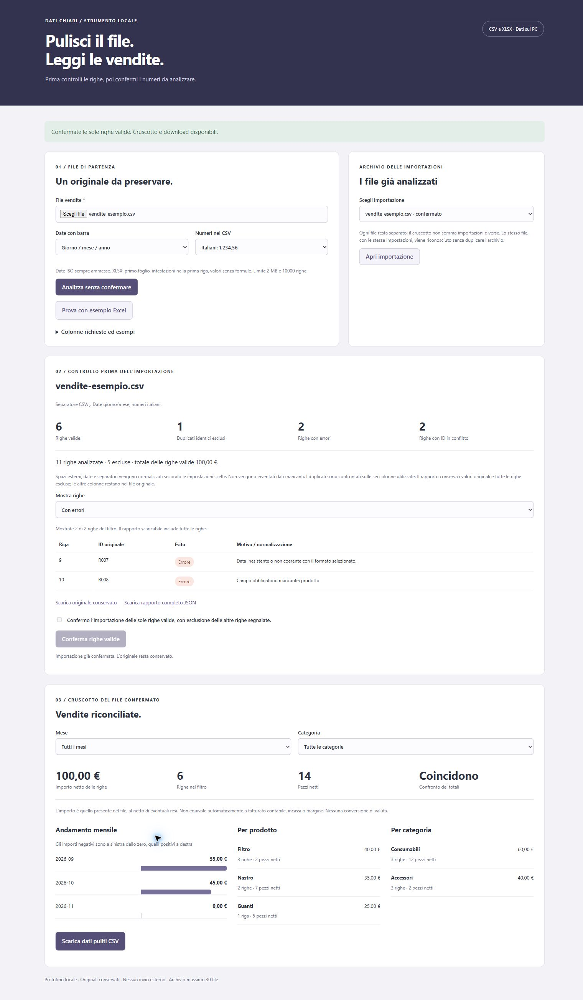
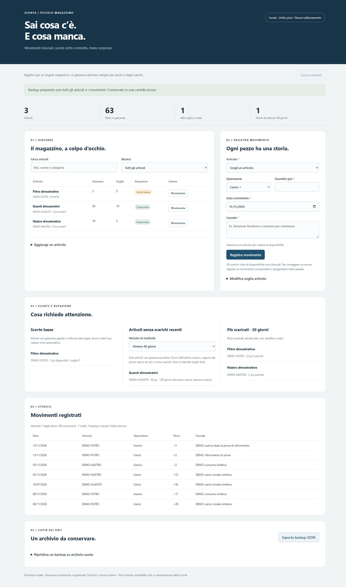
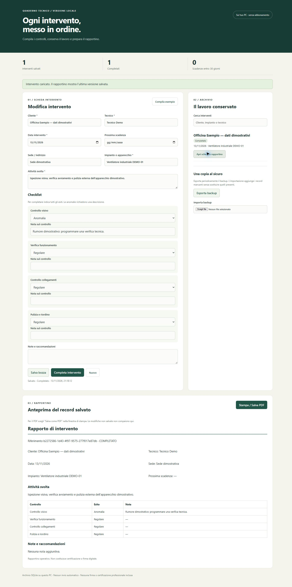

# Vincenzo Spinalbese

Python · JavaScript · SQLite · business automation

Six runnable personal demonstration applications, built with substantial AI assistance. The source code and tests are included in this repository. The interfaces are in Italian.

## Start here: see the application, then inspect the code

### Sales data cleaner

Validate CSV/XLSX exports, review invalid rows and duplicate IDs, confirm valid data and view a sales dashboard. Original files are preserved; uncertain values are flagged for review.



**[Open the code](projects/sales-data-cleaner/src)** · [Python backend](projects/sales-data-cleaner/src/server.py) · [Tests](projects/sales-data-cleaner/tests/test_vendite.py) · [Run instructions and sample files](projects/sales-data-cleaner)

### Inventory tracker

Register stock movements, inspect low-stock and inactivity indicators, and export a backup. The screenshot uses synthetic items and movements.



**[Open the code](projects/inventory-tracker/src)** · [Python backend](projects/inventory-tracker/src/server.py) · [Tests](projects/inventory-tracker/tests/test_magazzino.py) · [Run instructions](projects/inventory-tracker)

### Field service reports

Record an intervention, complete a checklist, retain a saved record and prepare a printable report. All names and equipment shown are demonstration data.



**[Open the code](projects/field-service-reports/src)** · [Python backend](projects/field-service-reports/src/server.py) · [Tests](projects/field-service-reports/tests/test_app.py) · [Run instructions](projects/field-service-reports)

## All six projects

| Project | Working example | Source code | Tests |
|---|---|---|---|
| Sales data cleaner | CSV/XLSX validation and sales dashboard | [src](projects/sales-data-cleaner/src) | [16 checks](projects/sales-data-cleaner/tests/test_vendite.py) |
| Inventory tracker | Stock movements, low-stock alerts and inactivity | [src](projects/inventory-tracker/src) | [13 checks](projects/inventory-tracker/tests/test_magazzino.py) |
| Field service reports | Saved interventions, checklists and PDF reports | [src](projects/field-service-reports/src) | [11 checks](projects/field-service-reports/tests/test_app.py) |
| Print quote calculator | Versioned price lists and reproducible estimates | [src](projects/print-quote-calculator/src) | [9 checks](projects/print-quote-calculator/tests/test_tipografia.py) |
| Artwork approval | Image versions and explicit approval history | [src](projects/artwork-approval/src) | [16 checks](projects/artwork-approval/tests/test_bozze.py) |
| Equipment rental | Date-based capacity, reservations and overdue returns | [src](projects/equipment-rental/src) | [17 checks](projects/equipment-rental/tests/test_noleggio.py) |

## Try an application on your computer

Use Python 3.12. Download or clone this repository, open its folder and run:

```sh
python -m pip install -r requirements.txt
cd projects/sales-data-cleaner
python src/server.py
```

Open **http://127.0.0.1:8769** in your browser. Sample CSV/XLSX files are in `projects/sales-data-cleaner/data`. Press Ctrl+C in the terminal to stop the server. Each project's README has its own port and run instructions.

To run this project's checks, stop its server and run from the project folder:

```sh
python -m unittest discover -s tests -v
```

The Python backends run locally. GitHub displays their code and screenshots; this repository does not provide a hosted, clickable deployment of the applications.

## Verification and scope

[82 tests passed on the publication copy](VERIFICATION.md), checked on 14 November 2026. Screenshots are from local functional checks with synthetic data. Only source code, documentation and selected sample fixtures are published; databases and credentials are excluded.

These are personal demonstration projects, not paid client case studies or production deployments. AI tools contributed substantially to implementation. Production hosting, authentication, multi-user permissions and operational security need separate work.

## Services

CSV/Excel processing, Python scripts, PDF reports, internal dashboards and small workflow tools. API and n8n integrations are scoped separately to the client's systems; this repository's six application examples focus on Python/JavaScript/SQLite.

Based in Italy. Italian: native. English: conversational. Scope, cost and availability are agreed before work starts.
