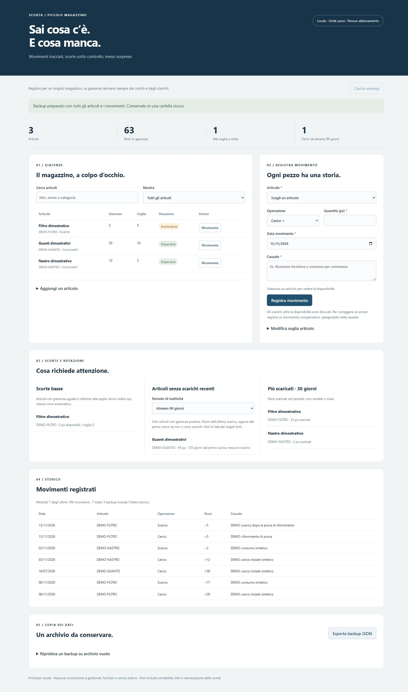

# Inventory tracker

Stock movements, low-stock alerts and inactivity analysis.

Personal demonstration project developed with AI assistance. This is not a client case study or a production deployment. The application interface is in Italian.

## Preview and source

Screenshot of the running application with synthetic demonstration data.



[Open Python backend](src/server.py) · [Open browser code](src/app.js) · [Open tests](tests)

## Run locally

From this directory, with Python 3.12:

```sh
python -m pip install -r ../../requirements.txt
python src/server.py
```

Open http://127.0.0.1:8768. Stop with the application's stop control or Ctrl+C. Local records are created at runtime and are excluded from this repository.

## Tests

```sh
python -m unittest discover -s tests -v
```

Tests use temporary storage and synthetic data. See the top-level verification report for the tested snapshot.

## Deployment scope

Built for local use. Internet deployment, multi-user identity and permissions, operational monitoring and production security require separate implementation and review.
